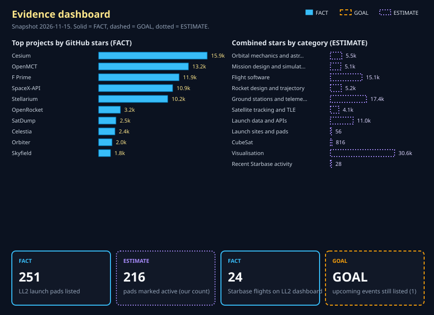

# Awesome Craft Space 

> A curated list of open-source tools for spaceflight and rockets — orbit simulation, telemetry, launch data and more.

Open-source software for designing trajectories, flying flight software, tracking satellites and reading launch data. Every project has a public repository that was checked on 2026-11-15. Figures on the dashboard are tagged FACT (measured, with a cited source and date), GOAL (a stated plan, not a result) or ESTIMATE (a sum or count computed here). The pixel banner is an original scene; it does not use company logos or wordmarks. This list does not include unverified cost claims.

## Contents

- [Dashboard](#dashboard)
- [Orbital mechanics and astrodynamics](#orbital-mechanics-and-astrodynamics)
- [Mission design and simulation](#mission-design-and-simulation)
- [Flight software](#flight-software)
- [Rocket design and trajectory](#rocket-design-and-trajectory)
- [Ground stations and telemetry](#ground-stations-and-telemetry)
- [Satellite tracking and TLE](#satellite-tracking-and-tle)
- [Launch data and APIs](#launch-data-and-apis)
- [Launch sites and pads](#launch-sites-and-pads)
- [CubeSat](#cubesat)
- [Visualisation](#visualisation)
- [Recent Starbase activity](#recent-starbase-activity)
- [Related lists](#related-lists)
- [Star history](#star-history)

## Dashboard

<table>
<tr>
<td align="center"><h2>48</h2>ESTIMATE listed projects</td>
<td align="center"><h2>11</h2>ESTIMATE categories</td>
<td align="center"><h2>94.9k</h2>ESTIMATE combined GitHub stars</td>
<td align="center"><h2>16.2k</h2>ESTIMATE combined GitHub forks</td>
<td align="center"><h2>36/47</h2>ESTIMATE GitHub repos pushed in the last 30 days</td>
<td align="center"><h2>11</h2>ESTIMATE languages among GitHub repos</td>
</tr>
</table>

### How the figures are tagged

<table>
<tr><th>Tag</th><th>Claim</th></tr>
<tr><td>FACT </td><td>Individual GitHub star, fork and last-push values come from the GitHub API, snapshot 2026-11-15, stored in stats.tsv.</td></tr>
<tr><td>ESTIMATE </td><td>Combined GitHub stars (94.9k, or 94,933) are the arithmetic sum of stargazers_count for the 47 GitHub-hosted entries only. SatNOGS Network is hosted on GitLab and is excluded from this sum.</td></tr>
<tr><td>ESTIMATE </td><td>Combined forks (16.2k), unique languages (11) and the 36/47 repos pushed on or after 2026-10-16 are counts computed from that same snapshot.</td></tr>
<tr><td>FACT </td><td>Launch Library 2 reported 251 pads on 2026-11-15 (API 2.3.0, ordered id pagination).</td></tr>
<tr><td>ESTIMATE </td><td>216 of those pads have active=true in the snapshot (our count of the active flag).</td></tr>
<tr><td>FACT </td><td>The Starship dashboard listed 24 previous launches and 0 upcoming launches on 2026-11-15.</td></tr>
<tr><td>ESTIMATE </td><td>Of those previous launches, 16 are recorded as Success, 5 as Failure and 3 as Partial Failure (our grouping of the LL2 status abbrev).</td></tr>
<tr><td>GOAL </td><td>Starship Orbital Catch Attempt remains listed as an upcoming LL2 event (date 2026-11-14 21:20:10 UTC / 2026-11-15 05:20:10 MYT). No outcome is recorded in the dashboard, so it is not treated as a result.</td></tr>
<tr><td>GOAL </td><td>Copper describes itself as a runtime aimed at spacefaring systems — a project goal, not a flown result.</td></tr>
</table>

Each flight outcome in the Starbase table is a FACT with its LL2 timestamp. Announced next flights or catch attempts are GOAL. This list does not invent upcoming launches or catch results.

### Leaderboard

Individual star counts below are FACT values from the 2026-11-15 GitHub API snapshot.

<table>
<tr><th>Rank</th><th>Project</th><th align="right">Stars</th><th></th></tr>

<tr><td align="center">🥇</td><td><b>Cesium</b></td><td align="right">15.9k</td><td><code>████████████████████</code></td></tr>
<tr><td align="center">🥈</td><td><b>OpenMCT</b></td><td align="right">13.2k</td><td><code>█████████████████</code></td></tr>
<tr><td align="center">🥉</td><td><b>F Prime</b></td><td align="right">11.9k</td><td><code>███████████████</code></td></tr>
<tr><td align="center">4</td><td><b>SpaceX-API</b></td><td align="right">10.9k</td><td><code>██████████████</code></td></tr>
<tr><td align="center">5</td><td><b>Stellarium</b></td><td align="right">10.2k</td><td><code>█████████████</code></td></tr>
<tr><td align="center">6</td><td><b>OpenRocket</b></td><td align="right">3.2k</td><td><code>████</code></td></tr>
<tr><td align="center">7</td><td><b>SatDump</b></td><td align="right">2.5k</td><td><code>███</code></td></tr>
<tr><td align="center">8</td><td><b>Celestia</b></td><td align="right">2.4k</td><td><code>███</code></td></tr>
<tr><td align="center">9</td><td><b>Orbiter</b></td><td align="right">2.0k</td><td><code>███</code></td></tr>
<tr><td align="center">10</td><td><b>Skyfield</b></td><td align="right">1.8k</td><td><code>██</code></td></tr>
</table>

### Licences

           

Licence badges use the project's SPDX identifier when GitHub detects one, or the text of the licence file when that identifier is missing. "Undeclared" means no licence file was confirmed at the repository HEAD on the snapshot date. The OpenC3 Builder's License V2 and NASA Open Source Agreement 1.3 are not OSI-approved; read them before you use those projects. Archived and unmaintained projects stay in the star sum and are flagged in their entries.

### Sources

<table>
<tr><th>Source</th><th>What it supports</th></tr>
<tr><td>GitHub API, snapshot 2026-11-15 (Asia/Kuala_Lumpur calendar date), stored in <code>stats.tsv</code></td><td>stargazers_count, forks_count, license, language and pushed_at for 47 repositories.</td></tr>
<tr><td>Launch Library 2 2.3.0 <a href="https://ll.thespacedevs.com/2.3.0/pads/">pads</a> (ordered by id, pages of 100) and <a href="https://ll.thespacedevs.com/2.3.0/dashboard/starship/">Starship dashboard</a>, snapshot 2026-11-15</td><td>Stored in <code>data/launch-pads.csv</code> and <code>data/starbase-recent.csv</code>. Refresh with <code>python3 fetch_launch_data.py</code>.</td></tr>
<tr><td>Project licence files read on 2026-11-15</td><td>OpenRocket GPL-3.0-or-later, OpenMCT Apache-2.0, OpenSpace MIT, Trick NASA Open Source Agreement 1.3, OpenC3 Builder's License V2.</td></tr>
<tr><td>SatNOGS Network GitLab project metadata, 2026-11-15</td><td>star_count 60, not mixed into the GitHub star total.</td></tr>
</table>

## Orbital mechanics and astrodynamics

- [ANISE](https://github.com/nyx-space/anise) - Rust toolkit for SPICE-style trajectory, orientation and ephemeris work. 
- [hapsira](https://github.com/pleiszenburg/hapsira) - Community fork of poliastro for astrodynamics in Python. Unmaintained (last push 2024-05-09). 
- [Nyx](https://github.com/nyx-space/nyx) - High-fidelity astrodynamics and mission-design toolkit written in Rust. 
- [Orekit](https://github.com/CS-SI/Orekit) - Low-level space dynamics library. The GitHub repository is a mirror; development happens on gitlab.orekit.org. 
- [poliastro](https://github.com/poliastro/poliastro) - Python astrodynamics library. Archived (last push 2023-10-14); see hapsira for a community fork. 
- [pykep](https://github.com/esa/pykep) - ESA toolkit for interplanetary trajectory design and optimisation. 
- [python-sgp4](https://github.com/brandon-rhodes/python-sgp4) - Python implementation of the SGP4/SDP4 satellite propagator. 
- [Skyfield](https://github.com/skyfielders/python-skyfield) - Astronomy and Earth-satellite positions computed from official almanac data. 
- [SpiceyPy](https://github.com/AndrewAnnex/SpiceyPy) - Pythonic wrapper for NASA's SPICE toolkit. 
- [Tudat](https://github.com/tudat-team/tudatpy) - TU Delft astrodynamics toolbox, with a Python interface around the C++ core. 

## Mission design and simulation

- [42](https://github.com/ericstoneking/42) - General-purpose spacecraft attitude and orbit simulation. No licence file was present at the repository HEAD on 2026-11-15. 
- [Basilisk](https://github.com/AVSLab/basilisk) - Modular astrodynamics and spacecraft simulation framework from CU Boulder's AVS Lab. 
- [GMAT](https://github.com/nasa/GMAT) - NASA's General Mission Analysis Tool for spacecraft trajectory design and optimisation. 
- [NOS3](https://github.com/nasa/nos3) - NASA Operational Simulator for Small Satellites. GitHub did not detect a standard SPDX licence. 
- [Orbiter](https://github.com/orbitersim/orbiter) - Realistic spaceflight simulator with a long-standing add-on ecosystem. 
- [OSP-Magnum](https://github.com/TheOpenSpaceProgram/osp-magnum) - Open-source spaceflight game and simulation project in the spirit of Kerbal Space Program. 
- [pagmo](https://github.com/esa/pagmo2) - ESA's platform for massively parallel optimisation, often used for trajectory problems. 
- [Trick](https://github.com/nasa/trick) - NASA simulation framework used for flight software testbeds. Licensed under the NASA Open Source Agreement 1.3, which is not OSI-approved. 

## Flight software

- [cFS](https://github.com/nasa/cFS) - NASA Core Flight System, a reusable flight software framework used across many missions. 
- [Copper](https://github.com/copper-project/copper-rs) - Rust runtime for robotics and, as a stated project goal, future spacefaring systems. 
- [F Prime](https://github.com/nasa/fprime) - NASA flight software and embedded systems framework, flown on missions including Ingenuity. 
- [NanoSat MO Framework](https://github.com/esa/nanosat-mo-framework) - ESA CCSDS Mission Operations framework for nanosatellites. No licence file was present at the repository HEAD on 2026-11-15. 

## Rocket design and trajectory

- [openMotor](https://github.com/reilleya/openMotor) - Internal ballistics simulator for commercial and experimental solid rocket motors. 
- [OpenRocket](https://github.com/openrocket/openrocket) - Model-rocket design and simulation. The licence is GPL-3.0-or-later with an additional permission for data files. 
- [RocketCEA](https://github.com/sonofeft/RocketCEA) - Python wrapper for NASA's Chemical Equilibrium with Applications code. 
- [RocketPy](https://github.com/RocketPy-Team/RocketPy) - Next-generation six-degree-of-freedom rocket trajectory simulator in Python. 

## Ground stations and telemetry

- [gr-satellites](https://github.com/daniestevez/gr-satellites) - GNU Radio decoders for amateur and scientific satellite telemetry. 
- [OpenC3 COSMOS](https://github.com/OpenC3/cosmos) - Command and control platform for mission operations. Distributed under the OpenC3 Builder's License V2, which is source-available and not OSI-approved. 
- [OpenMCT](https://github.com/nasa/openmct) - NASA web-based mission control framework for telemetry display and operations tools. 
- [SatDump](https://github.com/SatDump/SatDump) - Multi-mission satellite data decoder, with support for weather and Earth-observation downlinks. 
- [SatNOGS Network](https://gitlab.com/librespacefoundation/satnogs/satnogs-network) - Libre Space Foundation network of volunteer satellite ground stations. Official source is on GitLab; a SatNOGS Client lives in the same group. GitLab stars are not included in the combined GitHub star total.
- [YAMCS](https://github.com/yamcs/yamcs) - Mission control system for telemetry, telecommand and packet processing. 

## Satellite tracking and TLE

- [Gpredict](https://github.com/csete/gpredict) - Real-time satellite tracking and orbit prediction application. 
- [KeepTrack](https://github.com/thkruz/keeptrack.space) - Browser-based space-object visualisation and tracking workbench. 
- [orbit-predictor](https://github.com/satellogic/orbit-predictor) - Python library for satellite pass prediction from TLEs. Unmaintained (last push 2025-06-16). 
- [satellite.js](https://github.com/shashwatak/satellite-js) - JavaScript port of the SGP4/SDP4 propagator for browser and Node.js use. 

## Launch data and APIs

Launch Library 2 itself is a public HTTP API, not a public application repository, so it is not listed as a software entry. Official examples for the pad and location endpoints live under Launch sites and pads. Combined GitHub stars exclude non-GitHub hosts.

- [Spaceflight News API](https://github.com/TheSpaceDevs/spaceflightnewsapi) - News and blog API from TheSpaceDevs. No licence file was present at the repository HEAD on 2026-11-15. 
- [SpaceX-API](https://github.com/r-spacex/SpaceX-API) - Unofficial community API for historical SpaceX launch data. Archived (last push 2024-08-17). 

## Launch sites and pads

Open data and official examples for launch sites. The snapshot in `data/launch-pads.csv` has 251 pads (216 with `active=true`) from Launch Library 2 2.3.0, fetched 2026-11-15. Columns are name, location, country, latitude, longitude, total_launch_count, active, source_url and fetch_date. Regenerate it with `python3 fetch_launch_data.py`, which pages `/pads/?limit=100&ordering=id` and respects the anonymous free-tier budget of about 15 requests per hour. A general open-source NOTAM or launch-window tool was not included because no well-maintained public repository was verified for this list. LL2 notices and road-closure fields are the open data path for related constraints.

- [TheSpaceDevs Tutorials](https://github.com/TheSpaceDevs/Tutorials) - Official examples for Launch Library 2, including the pad and location endpoints used to build the snapshot in this repository. 

## CubeSat

- [libcsp](https://github.com/libcsp/libcsp) - Cubed Satellite Protocol, a small network-layer stack used on many CubeSats. 
- [OpenLST](https://github.com/OpenLST/openlst) - Open-source radio design based on the Planet Line-of-Sight Transceiver. Unmaintained (last push 2023-12-04). 

## Visualisation

- [Celestia](https://github.com/CelestiaProject/Celestia) - Real-time 3D space simulation that lets you travel through the solar system and beyond. 
- [Cesium](https://github.com/CesiumGS/cesium) - Open geospatial 3D globe and map engine for the web. 
- [OpenSpace](https://github.com/OpenSpace/OpenSpace) - Interactive data visualisation software for the known universe, used in planetariums and research. 
- [Stellarium](https://github.com/Stellarium/stellarium) - Planetarium software that renders a realistic sky in real time. 
- [WorldWind Java](https://github.com/NASAWorldWind/WorldWindJava) - NASA virtual globe SDK. No licence file was confirmed at the repository HEAD on 2026-11-15. 

## Recent Starbase activity

Latest Starship flights and events at Starbase, Texas, from Launch Library 2, plus community tools that extract webcast telemetry. The snapshot in `data/starbase-recent.csv` has 25 rows (24 FACT launches and 1 GOAL event), fetched 2026-11-15. Times are given in UTC and in Malaysia Time (Asia/Kuala_Lumpur, UTC+8). Flight outcomes from LL2 are FACT. Announced attempts still listed without an outcome are GOAL. Refresh the snapshot with `python3 fetch_launch_data.py`. This section does not invent catch results or upcoming flights.

<table>
<tr><th>Evidence</th><th>Mission or event</th><th>Status</th><th>Outcome</th><th>NET (UTC)</th><th>NET (MYT)</th><th>Pad</th></tr>
<tr><td>GOAL</td><td>Starship Orbital Catch Attempt</td><td>Spacecraft Landing</td><td>not recorded in LL2 dashboard</td><td>2026-11-14 21:20:10 UTC</td><td>2026-11-15 05:20:10 MYT</td><td></td></tr>
<tr><td>FACT</td><td>Starship | Starlink Group 31-2 (Starship Flight 15)</td><td>Launch Successful</td><td>Success</td><td>2026-11-13 22:47:36 UTC</td><td>2026-11-14 06:47:36 MYT</td><td>Orbital Launch Pad 2</td></tr>
<tr><td>FACT</td><td>Starship | Starlink Group 31-1 (Starship Flight 14)</td><td>Launch Successful</td><td>Success</td><td>2026-09-28 12:48:59 UTC</td><td>2026-09-28 20:48:59 MYT</td><td>Orbital Launch Pad 2</td></tr>
<tr><td>FACT</td><td>Starship | Flight 13</td><td>Launch Successful</td><td>Success</td><td>2026-07-24 22:51:00 UTC</td><td>2026-07-25 06:51:00 MYT</td><td>Orbital Launch Pad 2</td></tr>
<tr><td>FACT</td><td>Starship | Flight 12</td><td>Launch Successful</td><td>Success</td><td>2026-05-22 22:30:24 UTC</td><td>2026-05-23 06:30:24 MYT</td><td>Orbital Launch Pad 2</td></tr>
<tr><td>FACT</td><td>Starship | Flight 11</td><td>Launch Successful</td><td>Success</td><td>2025-10-13 23:23:41 UTC</td><td>2025-10-14 07:23:41 MYT</td><td>Orbital Launch Pad 1</td></tr>
<tr><td>FACT</td><td>Starship | Flight 10</td><td>Launch Successful</td><td>Success</td><td>2025-08-26 23:30:00 UTC</td><td>2025-08-27 07:30:00 MYT</td><td>Orbital Launch Pad 1</td></tr>
<tr><td>FACT</td><td>Starship | Flight 9</td><td>Launch Failure</td><td>Failure</td><td>2025-05-27 23:36:00 UTC</td><td>2025-05-28 07:36:00 MYT</td><td>Orbital Launch Pad 1</td></tr>
<tr><td>FACT</td><td>Starship | Flight 8</td><td>Launch Failure</td><td>Failure</td><td>2025-03-06 23:30:00 UTC</td><td>2025-03-07 07:30:00 MYT</td><td>Orbital Launch Pad 1</td></tr>
<tr><td>FACT</td><td>Starship | Flight 7</td><td>Launch Failure</td><td>Failure</td><td>2025-01-16 22:37:00 UTC</td><td>2025-01-17 06:37:00 MYT</td><td>Orbital Launch Pad 1</td></tr>
<tr><td>FACT</td><td>Starship | Integrated Flight Test 6</td><td>Launch Successful</td><td>Success</td><td>2024-11-19 22:00:00 UTC</td><td>2024-11-20 06:00:00 MYT</td><td>Orbital Launch Pad 1</td></tr>
<tr><td>FACT</td><td>Starship | Integrated Flight Test 5</td><td>Launch Successful</td><td>Success</td><td>2024-10-13 12:25:00 UTC</td><td>2024-10-13 20:25:00 MYT</td><td>Orbital Launch Pad 1</td></tr>
<tr><td>FACT</td><td>Starship | Integrated Flight Test 4</td><td>Launch Successful</td><td>Success</td><td>2024-06-06 12:50:00 UTC</td><td>2024-06-06 20:50:00 MYT</td><td>Orbital Launch Pad 1</td></tr>
<tr><td>FACT</td><td>Starship | Integrated Flight Test 3</td><td>Launch Successful</td><td>Success</td><td>2024-03-14 13:25:00 UTC</td><td>2024-03-14 21:25:00 MYT</td><td>Orbital Launch Pad 1</td></tr>
<tr><td>FACT</td><td>Starship | Integrated Flight Test 2</td><td>Launch was a Partial Failure</td><td>Partial Failure</td><td>2023-11-18 13:02:50 UTC</td><td>2023-11-18 21:02:50 MYT</td><td>Orbital Launch Pad 1</td></tr>
<tr><td>FACT</td><td>Starship | Integrated Flight Test</td><td>Launch Failure</td><td>Failure</td><td>2023-04-20 13:33:09 UTC</td><td>2023-04-20 21:33:09 MYT</td><td>Orbital Launch Pad 1</td></tr>
<tr><td>FACT</td><td>Starship SN15 | 10 km Flight</td><td>Launch Successful</td><td>Success</td><td>2021-05-05 22:24:00 UTC</td><td>2021-05-06 06:24:00 MYT</td><td>Suborbital Pad A</td></tr>
<tr><td>FACT</td><td>Starship SN11 | 10 km Flight</td><td>Launch Failure</td><td>Failure</td><td>2021-03-30 13:00:00 UTC</td><td>2021-03-30 21:00:00 MYT</td><td>Suborbital Pad B</td></tr>
<tr><td>FACT</td><td>Starship SN10 | 10 km Flight</td><td>Launch Successful</td><td>Success</td><td>2021-03-03 23:15:00 UTC</td><td>2021-03-04 07:15:00 MYT</td><td>Suborbital Pad A</td></tr>
<tr><td>FACT</td><td>Starship SN9 | 10 km Flight</td><td>Launch was a Partial Failure</td><td>Partial Failure</td><td>2021-02-02 20:25:15 UTC</td><td>2021-02-03 04:25:15 MYT</td><td>Suborbital Pad B</td></tr>
<tr><td>FACT</td><td>Starship SN8 | 12.5 km Flight</td><td>Launch was a Partial Failure</td><td>Partial Failure</td><td>2020-12-09 22:45:25 UTC</td><td>2020-12-10 06:45:25 MYT</td><td>Suborbital Pad A</td></tr>
<tr><td>FACT</td><td>Starship SN6 | 150m Hop</td><td>Launch Successful</td><td>Success</td><td>2020-09-03 17:48:00 UTC</td><td>2020-09-04 01:48:00 MYT</td><td>Suborbital Pad A</td></tr>
<tr><td>FACT</td><td>Starship SN5 | 150m Hop</td><td>Launch Successful</td><td>Success</td><td>2020-08-04 23:57:00 UTC</td><td>2020-08-05 07:57:00 MYT</td><td>Suborbital Pad A</td></tr>
<tr><td>FACT</td><td>Starship Hopper | 150m Hop</td><td>Launch Successful</td><td>Success</td><td>2019-08-27 22:02:00 UTC</td><td>2019-08-28 06:02:00 MYT</td><td>Suborbital Pad A</td></tr>
<tr><td>FACT</td><td>Starship Hopper | 20m Hop</td><td>Launch Successful</td><td>Success</td><td>2019-07-26 03:45:00 UTC</td><td>2019-07-26 11:45:00 MYT</td><td>Suborbital Pad A</td></tr>
</table>

Community tools that track or decode Starbase webcasts:

- [Starship Telemetry](https://github.com/chrisjbillington/starship_telemetry) - Extracts on-screen telemetry from Starship webcasts. Unmaintained (last push 2023-04-29). 
- [StarshipTelemetryExtractor](https://github.com/SofieBrink/StarshipTelemetryExtractor) - C# tool for reading telemetry overlays from Starship flight videos. Unmaintained (last push 2024-11-21). 

## Related lists

Other lists in the Awesome Craft series:

- [Awesome Craft](https://github.com/EdisonTKPcom/Awesome-Craft) - A curated list of open-source, self-hostable alternatives to popular SaaS tools.
- [Awesome Craft Agents](https://github.com/EdisonTKPcom/Awesome-Craft-Agents) - A curated list of open-source chat apps, coding agents, self-hosted agent bots, workflow automation and image-generation UIs.
- [Awesome Craft AI](https://github.com/EdisonTKPcom/Awesome-Craft-AI) - A curated list of open-source, self-hostable AI runtimes, servers, Hugging Face libraries and related infrastructure.
- [Awesome Craft BSC](https://github.com/EdisonTKPcom/Awesome-Craft-BSC) - A curated list of verified open-source clients, SDKs, dev tools and protocol code for BNB Smart Chain and opBNB.
- [Awesome Craft CUDA](https://github.com/EdisonTKPcom/Awesome-Craft-CUDA) - A curated list of open-source CUDA learning material, kernel libraries, tooling and portability projects.
- [Awesome Craft DeepSeek](https://github.com/EdisonTKPcom/Awesome-Craft-DeepSeek) - A curated list of official DeepSeek repositories and open-source harnesses, serving engines, eval tools and fine-tuning stacks that work with DeepSeek models.
- [Awesome Craft DevOps](https://github.com/EdisonTKPcom/Awesome-Craft-DevOps) - A curated list of open-source, self-hostable alternatives to popular DevOps and hosting SaaS tools.
- [Awesome Craft DNA](https://github.com/EdisonTKPcom/Awesome-Craft-DNA) - A curated list of open-source tools for DNA, genomics and synthetic biology.
- [Awesome Craft Ethereum](https://github.com/EdisonTKPcom/Awesome-Craft-Ethereum) - A curated list of verified open-source Ethereum clients, SDKs, dev frameworks, wallets and security tools.
- [Awesome Craft EV](https://github.com/EdisonTKPcom/Awesome-Craft-EV) - A curated list of open-source software and hardware for electric vehicles and charging.
- [Awesome Craft Hardware](https://github.com/EdisonTKPcom/Awesome-Craft-Hardware) - A curated list of open-source tools for PCB, FPGA, ASIC and chip design.
- [Awesome Craft Hyperliquid](https://github.com/EdisonTKPcom/Awesome-Craft-Hyperliquid) - A curated list of verified open-source SDKs, node tools, analytics and community libraries for the Hyperliquid ecosystem.
- [Awesome Craft Malaysia](https://github.com/EdisonTKPcom/Awesome-Craft-Malaysia) - A curated list of open-source tools useful to Malaysian SMEs, with verified MyInvois support called out separately.
- [Awesome Craft Mars](https://github.com/EdisonTKPcom/Awesome-Craft-Mars) - A curated list of open-source tools and open data for Mars missions and settlement planning.
- [Awesome Craft Neuro](https://github.com/EdisonTKPcom/Awesome-Craft-Neuro) - A curated list of open-source tools for brain-computer interfaces, electrophysiology and neurotechnology.
- [Awesome Craft Robotics](https://github.com/EdisonTKPcom/Awesome-Craft-Robotics) - A curated list of open-source robotics software and hardware, including Microduck, Unitree SDKs, open humanoids, arms, simulation and middleware.
- [Awesome Craft Solana](https://github.com/EdisonTKPcom/Awesome-Craft-Solana) - A curated list of verified open-source Solana clients, SDKs, frameworks, explorers and program libraries.
- [Awesome Craft Starlink](https://github.com/EdisonTKPcom/Awesome-Craft-Starlink) - A curated list of open-source tools for Starlink and other LEO satellite internet systems.
- [Awesome Craft Web3](https://github.com/EdisonTKPcom/Awesome-Craft-Web3) - A curated list of open-source DEX protocol code, self-custody software, indexers, frameworks and Blockchain infrastructure.

## Star history

## Contributing

Contributions welcome! Read the [contribution guidelines](contributing.md) first.

If this list helped you, give it a ⭐ so others can find it.

